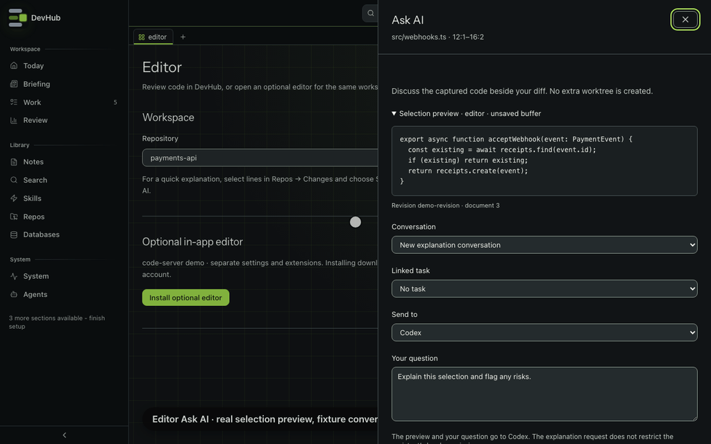

# Editor and selection chat

In **Repos → Changes**, select lines and choose **Send to AI**. DevHub opens a side panel with the exact selection, its diff revision and staged/unstaged source. Choose a task and an assistant, or continue an idle conversation from that checkout. Sending keeps the diff open and creates no extra worktree. `/editor` is not a sidebar row; **Open editor** from Changes takes you to the workspace's runtime controls.

The default request asks for an explanation. This is an instruction, not a permissions boundary: the assistant retains its existing local access. Discussion runs stay linked to their task without replacing its implementation Resume target.

*Real selection panel with invented code, tasks and assistant choices. The clip doesn't send code to a model or install code-server.*

Selections are limited to 12,000 characters; questions to 8,000. The submitted request keeps a stable request ID, so a retry of that request doesn't start a second discussion. Existing conversations must be idle and belong to the same checkout; their original task link stays fixed.

## Cursor or VS Code

The optional add-on lives in `extensions/devhub-selection`. Build it with `npm ci && npm run build` in that directory, then package with `vsce package` and install the VSIX. It uses the public VS Code extension API, not Cursor's private chat API. Selection commands work in Restricted Mode: the add-on reads the chosen buffer and never executes workspace code. Nothing is published to a marketplace by DevHub.

1. Open **Editor** (`/editor`, from Changes) and choose the matching repository.
2. Create a pairing code and copy it.
3. In the editor, run **DevHub: Pair this Workspace** and paste the code.
4. Select code and run **DevHub: Ask AI about Selection**.
5. Review the captured text in DevHub before sending. The in-app editor opens that preview in the existing DevHub window; installed editors open a preview link.

Pairing expires after 30 minutes or a dashboard restart and is limited to one workspace. A new code replaces the old one and clears its pending previews. **Revoke pairing** also clears pending selections. The editor stores its credential in SecretStorage; it never receives the dashboard's global credential. Pending selections expire after 10 minutes or when the dashboard process stops. Unsaved text is labelled and is not replaced with disk contents.

For WSL, install the add-on in the workspace's WSL extension host. Real paths must match; Windows paths are not silently translated.

## Optional in-app editor

**Open editor** from Changes takes you to the workspace's editor controls. Install code-server only if you want file editing inside DevHub. DevHub downloads a pinned release from Coder, checks its SHA-256 digest and version, and activates it only after extraction succeeds. Updates keep the previous installed version available for rollback.

The runtime starts on demand on a separate loopback origin, with its own random login password. Copy that password into the editor login. It has separate settings, recovery data and extensions under the OS application-data directory, outside your repository and content sync.

Only one workspace is open at a time. Save buffers before stopping or changing workspaces. There is no automatic idle shutdown. Closing the page keeps the editor running; stopping DevHub stops its owned process group, including after a dashboard crash. Reopening retains editor recovery data, but it does not guarantee recovery of every unsaved keystroke.

The managed profile starts with the DevHub Selection add-on and built-in language support. Automatic extension updates and telemetry are disabled; the initial extension allowlist contains only DevHub Selection. Changing that allowlist grants additional extensions your filesystem access. Use Open VSX or publisher-authorised VSIX files and check their licences.

Removing the runtime keeps repositories, extension settings and recovery data. Credentials and code are not included in URLs. Secret filenames and symlink escapes are excluded from selection submission, but ordinary source files can still contain secrets: inspect the preview.

macOS and Linux use the local service; Windows uses its WSL service and localhost forwarding. Browser login and process lifecycle have been exercised on macOS. Native WKWebView, WebKitGTK, Windows WebView2, IME and Cursor's WSL host still need platform testing before claiming parity.

## From an agent

Use `editor_selection` to read a paired-editor preview or pending workspace selection, and `editor_discussions` to inspect same-checkout conversation choices for that snapshot. After the human reviews the exact code, question and provider, `editor_discuss` requires `confirm: true` and a stable `requestId`. These tools cannot pair an editor, install a runtime or grant filesystem access. See [MCP server](../architecture/mcp-server.md#discuss-an-editor-selection).

See [Coder's configuration and extension guidance](https://coder.com/docs/code-server/FAQ), [VS Code's extension allowlist](https://code.visualstudio.com/docs/enterprise/extensions), and [remote extension placement](https://code.visualstudio.com/api/advanced-topics/remote-extensions).
