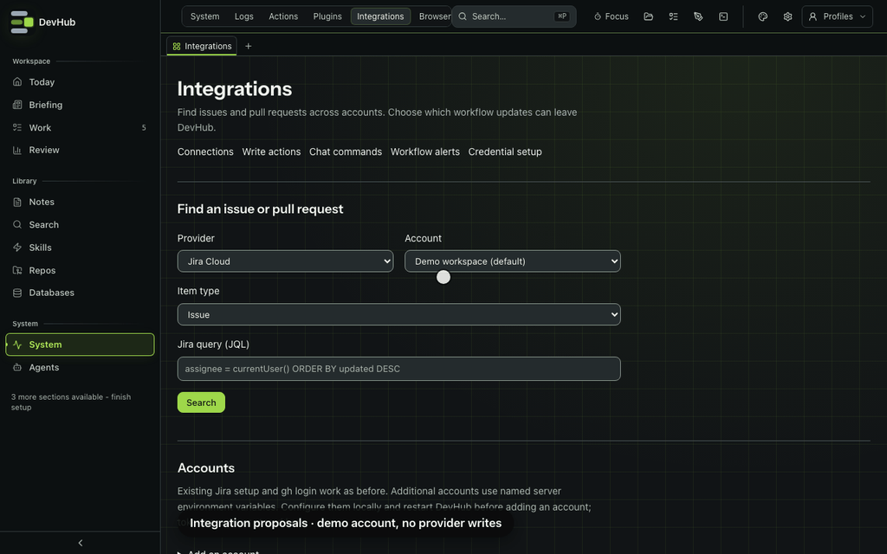
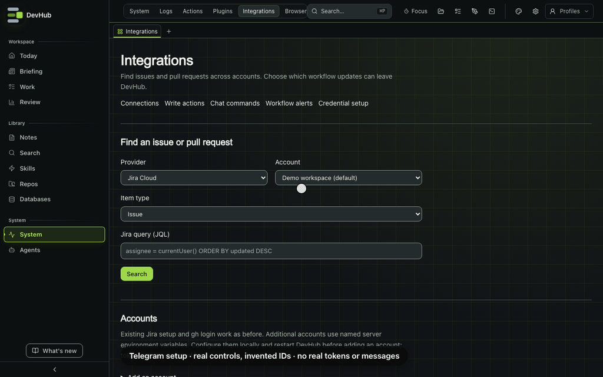

# Integrations and workflow alerts

Open **Integrations** (`/integrations`, System tab, or **⌘P**) to search Jira issues, GitHub Issues and pull requests, link them to tasks, and prepare write actions. Jira ticket creation, Jira transitions and GitHub PR creation, updates and publication all require a separate review and confirmation.



*Real Integrations UI with invented provider responses. The action is cancelled; no Jira/GitHub write or chat message is sent.*

## Find and link work

Choose a provider, account and item type, then enter JQL for Jira or a GitHub search query such as `repo:owner/repository is:open`. Use **Inspect** to see the native status and open the provider's page. Jira can list available transitions; GitHub PRs can show check runs. These controls don't apply a transition or change task completion.

Open Integrations from a task's workflow to link a result to that task. Added links record the provider, account, item type and native ID, so matching IDs from different accounts stay distinct. Existing Jira keys and GitHub PR links remain available. **Remove link** only removes a link added through Integrations; edit legacy links in the task editor.

## Accounts and credentials

The `default` Jira account uses existing Jira setup. The `default` GitHub account uses the service's `gh` login. Neither needs a credential migration.

For another account, set named variables in the server environment and restart DevHub, then open **Accounts → Add an account**. Enter an account ID, display name and token variable name, such as `WORK_GITHUB_TOKEN`. Enter the variable name, not its secret value. Jira also needs its `team.atlassian.net` domain and an email variable name. Account metadata stores these references; the service resolves the credentials when making a request.

Additional accounts currently support Jira Cloud and GitHub.com. On Windows, configure credentials in the WSL service that runs DevHub. Removing an account removes its saved configuration, not its token at the provider.

## Review and confirm a write

Choose **Write actions**, select the account and fill in the action. **Review action…** fetches the provider identity and current item or branch state. Nothing is sent until you choose the action-specific confirmation button.

The review shows the destination, connected user and exact submitted content. Jira creation keeps the existing default account's parent, issue type, team, assignee and sprint handling. Named Jira accounts support ticket creation without sprint/team inheritance. Transitions show both the current state and the native transition. PR updates show the old and new title and description. PR creation defaults to draft and requires branches already pushed to GitHub. Publishing a draft is a separate action.

Each proposal expires after 15 minutes. DevHub checks the remote revision and account again before sending. A changed preview needs fresh review. Jira and GitHub do not provide an atomic compare-and-write for every operation: another user can still change a branch or ticket between that check and the provider accepting the request.

**Recent actions** records cancelled, failed, succeeded and unknown outcomes. A timeout or interrupted request becomes **Outcome unknown** and is never retried automatically. Check Jira or GitHub before creating another action, because it could duplicate the first. Successful provider changes do not complete a DevHub task. Existing Jira controls use the same review dialog and keep their normal task and cache refresh behaviour.

Proposals include ticket/PR content and stay in local profile state outside Git and content sync. Chat requests identify their sender in the review. These gates cover DevHub-owned operations; they do not sandbox other software or assistants with direct credentials.

## Telegram setup

You can use the same bot for outbound alerts and optional inbound commands. Alerts need a bot token and chat ID; they **do not need a public webhook**. Commands are a separate opt-in and only accept private chats.



*Real Integrations UI with invented chat IDs and intercepted responses. No real bot token, webhook registration or Telegram message is used.*

### 1. Create your bot

In Telegram, open the official **@BotFather** account, send `/newbot`, then follow the prompts for a name and a username ending in `bot`. Keep the returned token private: anyone holding it can act as the bot. Never paste it into DevHub's UI, a ticket, a screenshot or a recording. See Telegram's [bot creation tutorial](https://core.telegram.org/bots/tutorial#obtain-your-bot-token).

### 2. Store the token on the server

Set `DEVHUB_TELEGRAM_TOKEN` in the environment of the service running DevHub, or in its ignored `dashboard/.env.local`. Restart that service. On Windows, this means the WSL service, not the Windows shell. Use the packaged app's environment when running DevHub.app rather than an unrelated checkout.

```dotenv
# Replace this placeholder locally; never commit the real value.
DEVHUB_TELEGRAM_TOKEN=<token-from-BotFather>
```

In **Workflow alerts**, enter only the variable name `DEVHUB_TELEGRAM_TOKEN` in **Bot token variable name**. A second bot can use a different server variable and its own destination.

### 3. Start or add the bot

For a private destination, open your new bot and choose **Start** (or send `/start`). For group alerts, add it to the intended group and send a command addressed to that bot. For a channel, add it with permission to post messages. Keep group privacy enabled unless you have a separate reason to change it. Inbound DevHub commands still require a private bot chat; group/channel IDs are for outbound alerts only.

### 4. Find the chat ID before registering a webhook

Open **Workflow alerts → Enable a destination**, choose **Telegram bot**, enter the token variable name and choose **Find my chat ID**. Select the intended recipient from **Chats found**; discovery never enables alerts or chooses a recipient automatically. It reads up to 100 pending updates server-side, newest within that batch first, and returns only chat type, chat ID and sender ID. It sends no message and supplies no offset, so it does not acknowledge or discard updates.

If no chats appear, send `/start` again and retry. Discovery refuses an active webhook and never calls `deleteWebhook`. If another app polls this bot, coordinate with its owner rather than interrupting it.

You can also inspect updates locally. This copyable command assumes the token is available in your shell; the token is deliberately a variable, not a literal. Don't enable shell tracing (`set -x`) or curl verbose output, and don't share the raw updates. `jq` shows only the IDs needed here:

```bash
curl --silent --show-error --fail-with-body --max-time 15 \
  "https://api.telegram.org/bot${DEVHUB_TELEGRAM_TOKEN}/getUpdates" \
  --data 'limit=100&timeout=0' \
  | jq '.result[] | (.message // .channel_post // empty) | {chat_id: .chat.id, type: .chat.type, user_id: .from.id}'
```

Record `chat_id` as a string, preserving a group's negative sign. For private commands, also record `user_id`; it normally matches the private chat ID. A helper bot you trust can sometimes identify your user/chat ID from a forwarded non-sensitive message, but privacy settings can hide the original sender and helpers see what you forward. Never forward a token or work content; verify the ID against your own bot before enabling alerts. See [getUpdates](https://core.telegram.org/bots/api#getupdates) and Telegram's [bot FAQ](https://core.telegram.org/bots/faq).

### 5. Enable alerts and test the destination

Add a label, select the events and read the fixed message preview. Approve the recipients/templates for the active work profile, then choose **Enable alerts**. Saving sends nothing. Use **Send test message** on the saved, enabled destination to send one fixed test immediately, even during quiet hours. The same control works for Slack, whose server variable is `DEVHUB_SLACK_WEBHOOK`.

A success means the provider accepted the test; check the actual chat. Errors explain rejected or uncertain delivery without showing tokens or provider response bodies. Tests appear in **Recent deliveries** and aren't retried automatically. Sending a test cannot enable a revoked destination, change consent or confirm a write.

### 6. Optionally configure inbound commands

Skip this step if you only want alerts. Generate a separate secret with `openssl rand -hex 32`, store it as `DEVHUB_TELEGRAM_WEBHOOK_SECRET`, and set these server variables. Replace the illustrative IDs and `work` with the private chat, sender and active profile shown in DevHub:

```dotenv
DEVHUB_TELEGRAM_COMMANDS=1
DEVHUB_TELEGRAM_WEBHOOK_SECRET=<generated-secret-not-the-bot-token>
DEVHUB_TELEGRAM_ALLOWLIST='[{"channel":"123456","user":"123456","profile":"work","accounts":["jira:default","github:default"]}]'
```

Restart DevHub. **Inbound chat commands** reports whether configuration is valid and how many sender/conversation pairs are allowed in this profile. Expose the exact webhook path as described next, then run this with the same token and webhook secret available in your local shell. Replace only the illustrative public origin:

```bash
DEVHUB_TELEGRAM_WEBHOOK_URL='https://hooks.example.com/api/integrations/chat/telegram'
curl --silent --show-error --fail-with-body --max-time 15 \
  "https://api.telegram.org/bot${DEVHUB_TELEGRAM_TOKEN}/setWebhook" \
  --data-urlencode "url=${DEVHUB_TELEGRAM_WEBHOOK_URL}" \
  --data-urlencode "secret_token=${DEVHUB_TELEGRAM_WEBHOOK_SECRET}" \
  --data-urlencode 'allowed_updates=["message"]'
```

`DEVHUB_TELEGRAM_WEBHOOK_URL` above is only a shell convenience, not a DevHub setting. Don't use `drop_pending_updates` just to finish setup: it discards queued messages. After registration, `getUpdates`/chat discovery is unavailable. The inbound handler checks Telegram's secret header and exact sender/chat/profile/account allowlist; it does not need to resolve the bot token. Send a fresh `/devhub help` in the private chat. Proposals still need human review and confirmation in DevHub.

### Expose only the webhook

Telegram needs a public HTTPS endpoint; tailnet-only Tailscale Serve cannot receive Telegram's requests. With **Tailscale Funnel**, put a path-restricting local reverse proxy in front of DevHub and funnel that proxy, not the whole dashboard. Funnel is public even if your normal dashboard address is private. Keep the original path intact and forward only `POST /api/integrations/chat/telegram` (plus Slack's exact path if used); return 404 for everything else. Follow the [Funnel documentation](https://tailscale.com/docs/reference/tailscale-cli/funnel) for TLS/port requirements. Don't expose `1337` wholesale or overwrite an existing Serve/Funnel configuration.

With **Cloudflare Tunnel**, a named tunnel can restrict the public hostname and exact path. Merge this into your tunnel's configuration, preserving its credentials and existing routes:

```yaml
ingress:
  - hostname: hooks.example.com
    path: ^/api/integrations/chat/telegram$
    service: http://127.0.0.1:1337
  - service: http_status:404
```

Validate the rules with `cloudflared tunnel ingress validate`, and check both the webhook and an unrelated URL with `cloudflared tunnel ingress rule`. The webhook must reach DevHub without an interactive Cloudflare Access login; all other routes must stay private or return 404. Preserve `X-Telegram-Bot-Api-Secret-Token`, don't log it or request bodies, and never use the bot token in a public URL. Cloudflare's [ingress configuration guide](https://developers.cloudflare.com/cloudflare-one/networks/connectors/cloudflare-tunnel/do-more-with-tunnels/local-management/configuration-file/) describes exact-path matching and the required catch-all.

### Telegram troubleshooting

| Symptom | What to check |
| --- | --- |
| No chats found | Start the bot and send a fresh command. Updates already consumed by another reader may be absent. Confirm you're using the right bot variable. |
| Discovery reports an active webhook / 409 | Enter the saved chat ID manually. Don't remove a working webhook or use a negative offset to discard updates. |
| Test rejected / chat not found | Preserve the chat ID's sign; start/add the bot and give it permission to post. Confirm token and chat belong to the same bot. |
| Recipient blocked / 403 | Unblock the bot or restore its membership/permissions, then explicitly retry. |
| Credential changed | Restart after updating the server token, then **Change settings** and approve the destination again. Tests cannot bypass fresh consent. |
| Rate limited / 429 | Wait before sending another test; tests aren't automatically queued for retry. |
| Delivery unknown | Check the chat before retrying; a duplicate is possible. Inspect Recent deliveries rather than repeatedly clicking Test. |
| Commands disabled / configuration needs attention | Check `DEVHUB_TELEGRAM_COMMANDS=1`, valid allowlist JSON, active profile and a 32–256 character webhook secret; restart the correct service. |
| Webhook commands rejected | Use the same `secret_token` as the server secret, an exact private sender/chat pair and a fresh non-forwarded `/devhub` command. Chat cannot approve writes. |
| Webhook doesn't arrive | Check TLS, exact ingress path and header forwarding. Ensure no login screen intercepts it and DevHub is awake/running. Read `getWebhookInfo` locally for Telegram's pending/error status; don't publish its URL or errors unredacted. |

## Inbound chat commands

Inbound commands are separate from outbound alert consent and are disabled by default. Start with Slack, then Telegram private bot chats. Both require the active work profile and an exact sender/conversation allowlist. There is no wildcard, chat approval, shell execution or agent dispatch.

Configure these server environment variables locally and restart DevHub. Never commit their values:

| Provider | Variables |
| --- | --- |
| Slack | `DEVHUB_SLACK_COMMANDS=1`, `DEVHUB_SLACK_SIGNING_SECRET`, `DEVHUB_SLACK_ALLOWLIST` |
| Telegram | `DEVHUB_TELEGRAM_COMMANDS=1`, `DEVHUB_TELEGRAM_WEBHOOK_SECRET`, `DEVHUB_TELEGRAM_ALLOWLIST` |

Secrets must be 32–256 characters. Slack uses the app's signing secret. For Telegram, generate a random secret and supply that same value as `secret_token` when configuring `setWebhook`. The webhook reply uses Telegram's supported response-method format, so no bot token is stored by the inbound handler.

The allowlist is a JSON array. Use actual IDs and the work profile shown in DevHub; these are illustrative placeholders:

```json
[{"team":"T123","channel":"C123","user":"U123","profile":"work","accounts":["jira:default","github:default"]}]
```

Telegram uses numeric IDs as strings, omits `team` and accepts private chats only:

```json
[{"channel":"123456","user":"123456","profile":"work","accounts":["jira:default"]}]
```

Configure a Slack slash command named `/devhub` with an HTTPS request URL ending in `/api/integrations/chat/slack`. For Telegram, register `/api/integrations/chat/telegram` as the HTTPS webhook and request message updates. Expose only these exact webhook paths through the ingress; keep the dashboard and its write-confirmation endpoints behind authenticated access. This setup does not create a tunnel or expose a port for you.

Slack requests use HMAC verification over the raw body and a five-minute timestamp window. Telegram checks the webhook secret, message age, sender and private chat; forwarded and bot messages are rejected. Both persist replay receipts and limit each sender to ten unique commands per minute, with a global receipt ceiling. Disable the relevant `COMMANDS` variable and restart to revoke inbound access. Already queued proposals still need dashboard confirmation and can be cancelled there.

Commands:

- `/devhub help` lists the command grammar.
- `/devhub status` counts this sender's pending proposals; `status <proposal-id>` reports one outcome.
- `/devhub propose <JSON>` validates and queues one action. It performs no Jira/GitHub write and replies with the proposal ID. Open **Integrations → Recent actions** to review and confirm.

Example Jira ticket:

```text
/devhub propose {"action":"issue.create","provider":"jira","account":"default","projectKey":"APP","title":"Investigate the failing build","body":"Check the failure and record the fix."}
```

Example transition:

```text
/devhub propose {"action":"issue.transition","provider":"jira","account":"default","ref":{"provider":"jira","account":"default","kind":"issue","id":"APP-123"},"transitionId":"31"}
```

Example draft PR:

```text
/devhub propose {"action":"pr.create","provider":"github","account":"default","repo":"owner/repository","head":"feature/fix","base":"main","title":"Fix the build","body":"Describe the change and verification.","draft":true}
```

For `pr.update`, use a GitHub `ref` with kind `pr` and ID `owner/repository/123`, plus `title` and `body`. For `pr.publish`, use the same ref without title/body. Replies contain fixed status text and IDs; they do not echo ticket descriptions or provider errors. Command content itself is visible to the chat provider. Slack replies are ephemeral; Telegram bot chats are not secret chats.

The protocol follows [Slack request verification](https://docs.slack.dev/authentication/verifying-requests-from-slack/) and the [Telegram Bot API webhook contract](https://core.telegram.org/bots/api#setwebhook). WhatsApp stays parked; its paid Business API is outside this implementation.

## Enable workflow alerts

Alerts are off until you enable a destination. They apply to the active work profile shown on the page. Slack uses an incoming webhook for one chosen channel; Telegram uses a bot token and an explicit chat ID. WhatsApp is unavailable.

1. Set the Slack webhook URL or Telegram bot token in the server environment and restart DevHub. For Telegram, start the bot or add it to the chosen chat first.
2. Open **Workflow alerts → Enable a destination**. Choose the channel, add a label and enter the credential variable name. For Telegram, enter the chat ID too.
3. Select the event types. You can receive conversation attention, failed checks, review readiness, approval requests and PR attention.
4. Optionally set quiet hours with their time zone, and an authenticated HTTPS DevHub address reachable from your phone.
5. Read the message preview and approve the templates for that destination and work profile, then choose **Enable alerts**.

Enabling alerts sends no test message. **Send test message** is a separate explicit send for an enabled Slack or Telegram destination and records its result in Recent deliveries. Tests bypass quiet hours but never consent; rate-limited tests aren't automatically retried. Only matching workflow events after consent are queued. The worker delivers while DevHub is running and the matching work profile is active.

Messages contain fixed event text and, if configured, a task link. They don't include task titles, code, logs or conversations. The destination's recipients and provider can read and retain the message. Telegram bots don't use secret chats. Approvals still happen inside authenticated DevHub.

The optional address must be an HTTPS origin with no path, query, token or fragment, for example `https://devhub.example.com`. Configure authenticated remote access separately. A localhost link would point at the phone itself, so leaving the address blank sends instructions to open Task workflows instead.

## Delivery, retries and revocation

**Recent deliveries** shows pending, sent, failed, cancelled and unknown deliveries. Sent means the provider accepted the message; it doesn't mean someone read it. The durable outbox deduplicates workflow events and survives a DevHub restart. Quiet hours delay pending messages until the configured window ends.

Rate limits retry after the provider's delay with backoff, up to five attempts. A timeout, ambiguous response or restart during delivery leaves the result **unknown**. DevHub won't retry an unknown delivery automatically. Check the channel first, then acknowledge the possible duplicate before using **Retry delivery**. You can also cancel pending, failed or unknown deliveries.

**Revoke alerts** cancels queued deliveries under that consent. It can't retract messages already sent. Consent records a hash of the resolved credential as well as the work profile and selected events. If the credential changes, use **Change settings** to confirm its recipient with fresh consent. **Review and re-enable** restores a revoked destination without creating another record. Saving settings cancels the old consent’s queued deliveries.

Destination settings and the outbox stay in local profile state outside content sync. They contain credential variable names and hashes, not raw tokens or webhook URLs.

## Adding a provider

Source plugins can declare `dashboard.providers`. Each module exports a default array of `IntegrationProvider` objects. DevHub materialises static imports into an empty generated core baseline; a rebuild is required. Edit the plugin source rather than the copied dashboard files.

Packaged runtime plugins use a separate versioned `request-worker` protocol for reviewed pages, routes and MCP contributions. That protocol doesn't register source provider modules automatically or permit arbitrary imports into the packaged dashboard. Write-capable adapters implement `prepareWrite` and `executeWrite` alongside their advertised capabilities. The host owns proposal storage, expiry, review hashes and single-use execution. An adapter receiving an approval ID is trusted application code, not a security sandbox.

## Verification scope

Write and inbound-command fixtures cover confirmation, concurrent duplicate submission, stale previews, expiry, profile/account isolation, unknown outcomes, provider payloads, signed requests, allowlists and replay limits. No real Jira/GitHub writes or Slack/Telegram sends were performed; these tests use mocks.

Telegram coverage includes fixed Slack/Telegram test payloads, consent revisions, profile isolation, concurrent request deduplication, crash/unknown recovery, rate limits, redacted failures, non-consuming chat discovery, active-webhook refusal, authenticated API routes, read-only MCP status and UI success/error/empty states. Run `npm run test --prefix dashboard -- lib/integrations/alerts.test.ts lib/integrations/telegram.test.ts app/api/integrations app/integrations ../mcp-servers/devhub-server/src/tools/reviewed-workflows.test.ts --maxWorkers=2`, then `npm run verify`.

The Telegram setup GIF uses the existing disposable fixture/CDP/sharp pipeline (`DEMO_ONLY=telegram-setup DEVHUB_DEMO_SERVER=dev npm run demos:walkthroughs`), with invented IDs and intercepted discovery/consent/test responses. No live Telegram call occurs.

The proposal GIF exercises the review/cancel controls with mocked provider responses, not a live write. Native webviews, live-provider behaviour and externally exposed ingress remain separate verification work.

## From an agent

`integrations_list` reads providers, capabilities and account references; `integrations_proposals` reads the active profile's action history. `integrations_propose` creates a request and `integrations_review` prepares its preview. Neither executes a provider write, and there is no integration-confirm MCP tool. Open **Integrations → Recent actions** for the human's action-specific confirmation. `integrations_alert_destinations` lists saved destinations, consent revisions and recent deliveries, never tokens. `integrations_alert_test` sends a fixed test to an already enabled destination using `id`, its current `revision` and a UUID `requestId`; reuse that request ID after an uncertain transport result to avoid another send. `integrations_chat_status` reads command status, active-profile allowlist counts, webhook paths and required variable names without exposing their values. These tools cannot enable alerts/commands, edit an allowlist or approve writes. See [MCP server](../architecture/mcp-server.md#integration-proposals).
