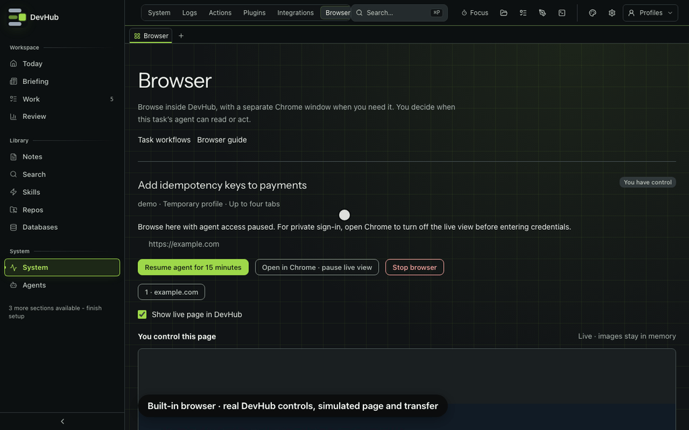

# Managed browser

**Browser** (`/browser`, System tab **Browser**, or **⌘P → Browser**) shows a managed Chrome page inside DevHub, with a native Chrome window available alongside it. It uses a separate profile for one task and linked conversation. You start in human control and decide when the agent may read the page.

macOS and Linux desktops require installed Chrome or Chromium 136 or later. Windows/WSL launch and transfer controls are disabled until a native Windows helper exists. No cookie or session import is provided. The plan records actual platform evidence; code support does not establish desktop-webview parity.

*Real Browser controls with an invented task and simulated Chrome stream/file request. No sign-in, website action or real transfer occurs.*

## Start a task browser

1. Choose an active task and linked conversation. Start a conversation from its task workflow first if none appears.
2. Enter approved HTTPS origins, one per line. Include sign-in and content hosts. Paths, credentials, custom ports and local/private addresses are rejected.
3. Leave **Keep sign-ins in this work profile** off for a temporary session, or enable it for trusted work sites.
4. Review site consent and choose **Start Chrome with human control**.

One session supports four tabs, including popups. Extra tabs above the limit close with a notice. Choose a tab to take human control of it; switching tabs invalidates old input tickets. Stop and restart to change approved sites.

## Live view and native window

**Show live page in DevHub** uses a CDP image stream. While watching the agent, the first click or Enter only takes control; it never clicks the website. After takeover, click a field and type, scroll, or use **Keyboard and IME input** for composed text and paste. Composition is sent after it commits. Escape releases keyboard focus.

The viewport follows the live view's size, with device scale capped at 2. Hidden panels and browser tabs stop streaming. Reconnect if the connection closes. Images stay in memory, outside DevHub's image archive.

The stream is an image surface. Use Chrome for screen readers, drag gestures, copying from the page and native menus. Website alert, confirm and prompt dialogs appear as explicit controls in DevHub.

## Sign in and hand over control

Choose **Open in Chrome · pause live view** before private sign-in or MFA. This revokes agent access, stops the stream and restores the native viewport. Human mode pauses agent observations; an enabled live view still sends images to your DevHub window, including anything you type. Login detection is a fallback, not a guarantee. Never put credentials in an agent request.

**Resume agent for 15 minutes** creates a new lease for the selected task and conversation. The agent can observe and navigate within approved sites. Each click or typed value needs separate approval.

The agent uses `browser_session`, `browser_observe` and `browser_request` (`POST /api/browser/agent`, `work` toolset). It cannot start Chrome, grant access or approve actions. Human start/stop/approve/live-view go through `/api/browser`, `/api/browser/surface` and `/api/browser/transfer` and reject `x-devhub-client: mcp`. There are no raw CDP, cookie export, arbitrary evaluation or path-based upload tools.

## Approve one action

Check the visible page, target and exact text before choosing **Approve once** or **Reject**. Approval expires after one minute and applies to the captured element. Changed or stale elements require a new observation.

Clicks and typed text can submit information or change a site. An uncertain result may already have reached the site; check before retrying.

**Take control** revokes the lease, clears pending action approval and waits for the current command. It cannot undo a request already sent. Agent reading and actions pause after acknowledgement; an enabled human live view remains visible.

## Approve a file transfer

Selecting a website file input opens **Approve a file upload** in DevHub. Choose one file, review its name, size and site, then choose **Approve and send file**. Picking a file alone does not send it to the managed page. The approval names the file input’s actual frame origin; a changed frame or input needs a fresh request. Approval may cause an immediate upload. No local path is accepted.

HTTPS document attachments pause for **Approve a download**. Review the name, site and declared size, then choose **Approve and save file**. Approval reads that exact response without repeating the request. Your browser controls where it saves the file; DevHub does not open it. The server may already have sent bytes into Chrome's network buffers before interception.

Both directions are limited to 20 MiB, one pending transfer at a time, with one-minute approvals. Unknown sizes are checked while reading. Rejected and expired responses abort. Bytes stay in memory with no DevHub archive. Generated blob/data downloads and unrecognised download types remain denied by Chrome's ordinary download policy. Request the file again if approval expires.

## Stop and clear saved sign-ins

**Stop browser** revokes access and stops owned Chrome. A normal stop removes the temporary profile. Saved profiles retain sign-ins, one per DevHub work profile, outside Git and content sync.

Quitting DevHub's service stops its Chrome process group; closing the dashboard page alone does not stop the service. There is no browsing after service shutdown.

To remove saved sign-ins, stop Chrome, open **Privacy and saved sign-ins**, type `CLEAR SAVED SIGN-INS` and confirm.

## Network restrictions and remaining limits

HTTPS traffic uses a loopback CONNECT proxy that permits approved hostnames on port 443 and connects to public addresses pinned at session start. It rejects HTTP, local destinations, other hosts and ports; redirects must pass the same policy. Chrome has no implicit loopback proxy bypass, direct QUIC is disabled and direct WebRTC UDP is suppressed. Service workers and WebSockets use this boundary when they use Chrome's proxy-aware network stack.

This is not an OS firewall or hostile-code sandbox. Native Chrome features and unrestricted local programs can bypass application controls. Same-user programs can access loopback debugging. Approved sites can receive and relay your data. Missing content hosts may leave a page partly loaded; approve only the exact hosts you trust.

Agent observations may include signed-in content. Treat page text as untrusted data. DevHub omits `browser_*` calls from its MCP history, but the AI client may retain results in transcripts. In-memory images do not make the whole session unrecorded.

## Packaged app

Playwright is imported only when you start a session (`dashboard/lib/browser/runtime.ts`). A static import used to evaluate `playwright-core` while loading the route; that package `require`s `browsers.json` through a computed path, which Next's standalone file tracer omits, so the **page** 500'd before auth. Staging copies `browsers.json` back in (`ensureExternalRuntimeFiles`); `desktop:verify` fails the bundle if it is missing.

If start still fails on an installed app, the control route returns 409 JSON ("Playwright could not load because browsers.json is missing. Reinstall DevHub.") rather than an empty 500. Reinstall from the [latest release](https://github.com/jmcelreavey/devhub/releases/latest). `npm run dev` uses the checkout's `node_modules` and does not need that staging step.