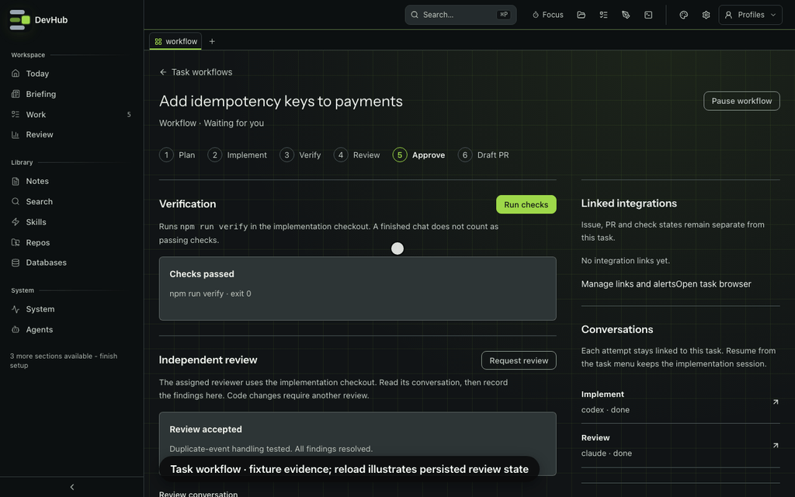

# Task checks and review persistence

Open **Task workflows** (`/workflow`), then a task. Its verification results, independent review, publication proposals and updates live on disk rather than in an open chat. Reopening DevHub brings that evidence back; it does not approve, publish or repeat a command for you.

*Real workflow UI with invented evidence and a simulated decision. The recording reloads the page; restart recovery is covered by the workflow storage and recovery tests, not a live agent run.*

## Verify the implementation

Start an implementation linked to the task, then choose **Run checks** in its workflow. DevHub runs `npm run verify` in that implementation's checkout, with a ten-minute timeout. A check records its run, command, timestamps, exit code and code fingerprint.

Passing checks belong to that exact fingerprint, not just a branch name. The fingerprint covers HEAD and tracked/untracked code while excluding generated output. Code changes during verification leave the result interrupted. Later changes mark old checks and reviews stale and return the workflow to verification.

Checks can be **running**, **passed**, **failed** or **interrupted**. If no completion was recorded after the recovery window, DevHub marks the check interrupted and tells you to inspect the checkout. It never restarts an uncertain command automatically. Build output stays in the command's logs; the workflow keeps a short result rather than potentially secret-bearing output.

## Record an independent review

Choose an assigned reviewer in the implementation launch sheet, or use **Request review** in the workflow. After it finishes, select that completed review conversation, enter **Findings and resolutions**, choose an **Outcome**, and **Record review**.

The reviewer must be linked to this task, completed, and started against the same code fingerprint. Current passing checks are required before findings can be accepted. **Changes required** blocks publication; **All findings resolved** moves the task to waiting for your decision. A conversation being finished alone is not a passing review.

Planning, implementation, review and code-discussion attempts remain separate linked conversations. A discussion doesn't replace the task's implementation Resume target.

## Decide exactly what may happen

Under **Publication decisions**, use **Prepare a proposal** for commit/push, a draft PR, a ticket transition or task completion. Enter its destination and exact content. Current passing checks and a passing independent review are required.

**Approve this proposal** or **Reject** records your decision. Approval lasts 15 minutes and is bound to the implementation run, code fingerprint, destination and content hash. A code change, expired approval or changed content needs a new proposal. Approval is coordination, not a sandbox around an assistant that already has local command access.

A proposal isn't the action itself. The executor must claim the approved proposal once before acting and record a receipt afterwards. Claiming it moves the state to **outcome-unknown** first, so a crash cannot make the approval reusable. Check the destination before retrying an uncertain result. A successful task-completion receipt is what completes the workflow; a successful check, review or external ticket update does not.

## What survives a restart

Workflow state and its event history are written atomically under `notes/.config/task-workflows/<task-id>.json`. Linked run sidecars and the durable agent-run store restore conversation ownership. Reading a task reconciles that history and rechecks its evidence; missing checkouts can't retain publishable evidence.

The inbox puts unread updates first. **Mark read** saves the seen revision. **Enable desktop alerts** asks for OS notification permission; updates remain in the inbox when DevHub was closed or notifications weren't delivered. The separate [Slack integration](integrations.md#slack) sends task notifications.

**Pause workflow** prevents new checks, review recording and decisions, but doesn't stop its assistant. Resume before continuing. Complete and abandoned workflows retain their evidence.

## From an agent

Use `tasks_workflow_get` with a task ID to read its current revision, checks, reviews, proposals and updates, or omit it for the inbox. `tasks_workflow_review` records a real completed independent review against that revision. A `409` means refresh and check what changed, not silently resubmit.

No MCP tool in this group approves a publication proposal. Human decisions remain in Task workflows. The existing `tasks_implement_review` tool starts the assigned reviewer; it doesn't record a passing verdict by itself. See [MCP server](../architecture/mcp-server.md#durable-task-evidence).
