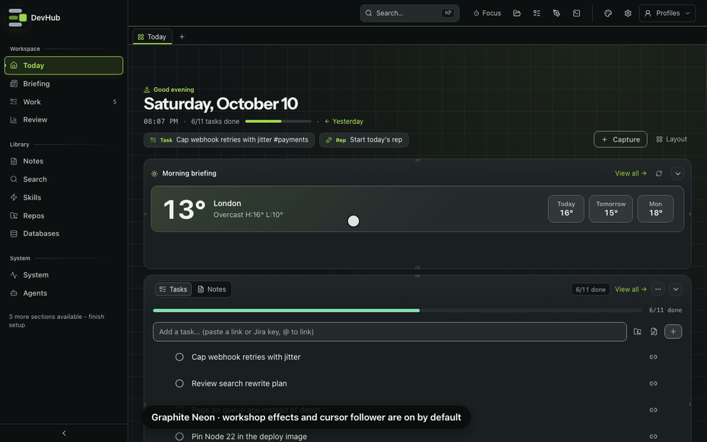

# Theming

DevHub supports visual themes and accent choices so the dashboard feels comfortable for daily use.

## Theme Controls

Everything lives in one place: the **Appearance** button (the palette icon) in the dashboard top bar.

| Control | Behavior |
| ------- | -------- |
| Mode | **System**, **Light** or **Dark**. System follows the OS colour scheme. |
| Theme | One of the core themes below, or one an enabled plugin adds. Each swatch previews the theme's dark and light colours. |

**Graphite Neon (Default)** and **Hollow (Halloween) 🎃** stay first in every picker. The remaining themes each own a different material and mark:

| Theme | Character | Signature |
| ----- | --------- | --------- |
| Graphite Neon (Default) | Charcoal and lime workbench | Shift Dock, measuring grid, lime ring |
| Hollow (Halloween) 🎃 | Bruised ink and stained paper | Haunted arch, fog, spectral trail |
| Ember Dusk | Copper ink and warm paper | Ember mark, hearth light, flame-shaped follower |
| Abyss | Ocean ink and blue glass | Sonar mark, depth contours, concentric follower |
| Tokyo Night | Plum ink and violet light | Lantern mark, upper-edge wash, lantern follower |
| Porcelain Garden | Celadon and cream | Folded-leaf mark, garden light, petal follower |

Porcelain Garden replaces Catppuccin's appearance but keeps `catppuccin` as its saved id. No core ids are removed. An unknown or retired id falls back to the configured default (normally `graphite`).

The command palette (**⌘P**) uses the same names and descriptions. Search for **default** or **Halloween** to switch themes without changing your mode. The saved theme ids are still `graphite` and `hollow`, so existing preferences keep working.

Your choice is stored in `localStorage` (`devhub:theme` for the mode, `devhub:theme-preset` for the theme) and applied on first paint via an inline bootstrap script in `app/layout.tsx` to avoid a flash of the wrong palette.

### System mode

When Mode is **System**, DevHub resolves light or dark from `prefers-color-scheme` and keeps `data-theme-mode="system"`. `ThemeSystemSync` listens for OS changes and re-applies the palette without overwriting the saved setting.

When you pin **Dark** or **Light**, the resolved palette stays fixed until you pick System again.

## Shared Theme effects

Open **Appearance → Theme effects**, with any theme selected. The same panel shows that theme's mark and sample activity, grouped **Atmosphere**, **Feedback**, **Pointer** and optional **Extras** switches, plus **Reset this theme to defaults**. Reset affects only the selected theme. The master switch keeps your individual choices when it turns everything off.

The preview is labelled **Preview only**; it isn't a running agent. **Try task done** and **Try merge** trigger the selected theme's celebration, not a task or GitHub mutation. Each theme has a loader, ambient treatment, hover/press response, celebration and matching follower. Ambient treatments stay still in healthy workspaces; loaders move only while loading or in the explicit sample preview.

Each switch explains its reduced-motion behaviour: **static** retains a still treatment, **off** stops it, and **unchanged** applies to opt-in audio. System reduced motion, the DevHub animation kill-switch and hidden tabs stop moving effects without changing saved preferences. The native pointer always remains usable; fine-mouse followers hide over editors, text fields, terminals and iframes, and during keyboard navigation, dragging or scrolling.

Graphite and Hollow still use `devhub:graphite-effects` and `devhub:hollow-effects`. All saved booleans, including explicit offs and opt-in choices, survive. Hollow's new cursor setting inherits its old `interaction` value when absent, so an old disabled trail stays disabled. New settings receive the declared defaults; sound and scares remain off unless you enabled them. Other themes use `devhub:theme-effects:<id>`. Preferences stay separate across theme switches and browser tabs.

### Add a theme with effects

1. Add both palette blocks to `dashboard/app/globals.css` and metadata to `CORE_THEME_PRESETS` in `dashboard/lib/theme-presets.ts`. Keep swatches identical to `--bg` and `--accent`. Keep Graphite and Hollow pinned first.
2. Declare the theme in `dashboard/lib/theme-effects.ts`, then attach it as the preset's `effects`. Include a unique storage key, event, preview title/description, mark and task/merge messages. Each effect declares `id`, `label`, `description`, `default`, `group`, `reducedMotion` and optional `requires` ids. The master switch is shared, not another theme-specific control.
3. Add a compact SVG mark to `ThemeMark.tsx` and theme-scoped treatments to `theme-effects.css`. The shared gate sets `data-theme-fx-<id>` after applying the master switch, dependencies and motion policy. Gate every treatment with its flag; use transform/opacity for animation, avoid permanent frame loops and never overlay text. The existing mouse follower sleeps when settled and already protects editors and terminals.
4. Reuse the shared preview and reset. Don't add controls to the bottom of the theme list. For a specialised runtime, use the same saved keys and declarations, and keep its listeners mounted only while selected. Audio still needs an explicit user gesture.
5. Run registry/migration/bootstrap tests, AA contrast tests across all five surfaces in both modes, UI tests and `npm run verify`. Capture desktop/mobile, light/dark and reduced-motion screenshots. If retiring an id, add an explicit alias or preserve the default fallback in both first-paint bootstrap and runtime sanitisation.

Plugins without an effects declaration get a clear empty state; no core effect flags or follower leak into them. Plugin palette/logo/font materialisation stays unchanged.

## Graphite Neon (Default) workshop effects

Graphite Neon (Default) adds a lime-lit workshop around the Shift Dock mark. Open **Appearance** with Graphite Neon (Default) selected, then choose **Theme effects** to see **Neon workshop** and the individual switches. Every workshop effect, including the cursor follower, is **on by default**.

*Recorded against disposable demo data. The preview's activity and completion buttons are samples, not running agents.*

| Switch | What it does |
| ------ | ------------ |
| Theme effects | Master switch; turning it off keeps the palette and your individual choices. |
| Neon edges | Lime light along the dock and active surfaces. |
| Workshop grid | A fine measuring grid behind the workspace. |
| Ambient scan | Slow light passes along the workspace edge. |
| Dock loader | Shift Dock rails charge while the lime hub slides home. |
| Activity pulse | A soft pulse while agents and commands run; idle systems hold still. |
| Hover & press | Light sweeps on hover and a short snap on buttons and switches. |
| Finishing touches | A brief salute when a task completes or a tracked PR newly merges. **Try task done** and **Try merge** preview it. |
| Empty-state arrival | The idle dock settles into an empty panel. |
| Chart arrival | Bars and usage meters arrive when their data changes; values aren't decorative. |
| Cursor follower | A soft lime ring follows a mouse, expands over enabled controls and contracts on press. |

The follower decorates the native pointer; it doesn't replace it or intercept clicks. It steps aside over text inputs, code and note editors, terminals and iframes, and hides for keyboard navigation, scrolling, dragging and lost focus. It requires a fine mouse pointer, so touch devices don't get it. Turn off **Cursor follower** to remove only the ring.

Preferences are saved on this device in `localStorage` under `devhub:graphite-effects` and applied before first paint. They apply only to Graphite Neon (Default). Switching themes leaves your choices ready for next time.

System reduced motion and **⌘P → Toggle animations** stop animated effects and the follower while keeping static textures. Motion pauses in hidden tabs; decorative layers don't cover content or receive input. See [Motion](../contributing/motion.md).

## Hollow (Halloween)

Hollow (Halloween) 🎃 is an optional spooky Halloween theme: bruised near-black with dried-blood red, and stained paper for its light mode. It switches itself on once a year, in October (`lib/hollow-theme.ts`):

- **The first time you open DevHub in October**, Hollow (Halloween) 🎃 is applied before the first paint. DevHub remembers the theme you had.
- **If you pick another theme during October**, that choice sticks for the rest of the month.
- **When October ends**, DevHub puts your previous theme back, unless you chose a different one yourself. Your mode (System, Light or Dark) is left alone.

The bookkeeping is in `localStorage` (`devhub:hollow-season`), so it belongs to one browser (or the desktop app) at one address. Open DevHub from a different browser or port and that counts as a first open.

To switch Hollow (Halloween) off, open **Appearance** and pick any other theme. While it's selected, open the shared **Theme effects** section for the October notice and its switches. Nothing is appended beneath the theme list:

| Switch | What it does | Default |
| ------ | ------------ | ------- |
| Effects | Master switch. Off keeps the Hollow (Halloween) colours and drops every effect below. | On |
| Atmosphere | Layered fog, guttering light, grain and bottle wisps. | On |
| Creatures | Watching eyes, spiders and a shadow passing through the fog. | On |
| Rare events | A passing presence every few minutes. Needs Atmosphere, Creatures and motion. | On |
| Interaction | Cobweb sway, cracks and heading glitch. | On |
| Haunted mark | A candlelit arch while content arrives; static under reduced motion. | On |
| Sealed & settled | A spectral seal for completed tasks and merged PRs. | On |
| Spectral follower | Mouse trail, separately switchable from Interaction. | On, or the previous Interaction choice |
| Jump scares | Off unless you ask. Type `boo` outside a text field. | Off |
| Sound | A low drone. Starts on the click that turns it on and stops when the tab hides. | Off |

Reduced motion keeps the static textures (grain, vignette, stains) and turns off flicker, drifting, creatures, glitch, the cursor trail and jump scares. The **Toggle animations** action in the command palette turns motion off everywhere, Hollow (Halloween) included (see [Motion](../contributing/motion.md)).

## Plugin whitelabel (tier 3)

An enabled plugin can contribute branding: custom presets, default mode, fonts, logo, and a desktop app icon. The branding materialiser writes generated files locally (`plugin-branding.generated.*`) that `theme-presets.ts` and the layout consume. That happens when a checkout materialises the plugin, not inside an already built app. The Plugins page can review a branding declaration, but it will not enable or apply it.

- Plugin presets appear in the same Appearance menu as core themes.
- `defaultMode` can seed **system**, **dark**, or **light** for fresh installs; user overrides still win.
- Logo and fonts replace the sidebar chip and UI typeface when configured.

See [Plugins › Tier 3 — branding](../architecture/plugins.md#tier-3--branding-whitelabel) and [Creating a Plugin › Whitelabel](../contributing/creating-plugins.md#5c-optional-whitelabel-devhub-tier-3-branding) for the manifest layout.

## Customization Guidance

- Prefer theme variables over one-off hardcoded colors.
- Keep contrast high enough for daily work.
- Test mobile and desktop views.
- Avoid making core status colors ambiguous.

## Contributor Notes

When adding UI, use existing visual patterns before introducing a new one. If a new visual pattern is needed, make it reusable.
