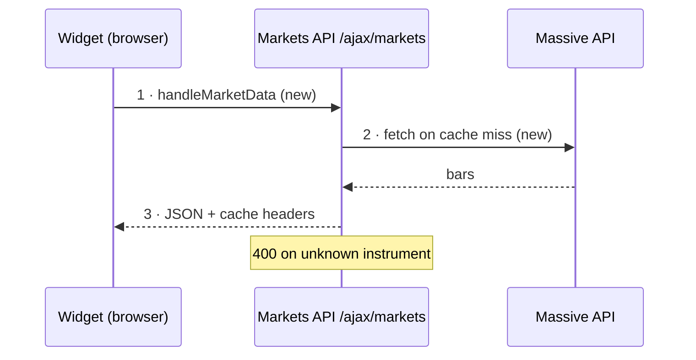

# Saving the review as a note

Read from `pr-explain-review` only when the request names a notes path or you are in local pre-PR mode.

When the request names a notes path — the dashboard "Review" button appends
`Notes MCP path: pr-reviews/<owner>-<repo>-<number>` — save the finished
write-up there so the dashboard can link to it.

**Write through the notes MCP, never by creating files directly.** Always use
**`notes_write`** with the exact path given. The launch command pins `NOTES_DIR`
to the DevHub repo, and the notes MCP is what knows that location — writing a
`.json`/`.md` file by hand lands it in the wrong place (the bug this flow
exists to avoid). If the notes MCP isn't available, say so instead of writing
files; don't guess a path.

Before `notes_write`, call `notes_read` and `entity_links_read` for that path
when it exists. Preserve every existing task backlink in
the replacement Markdown; `notes_write` replaces the whole note, and the
automatic PR/repo links cannot reconstruct task context you delete.

Pass Markdown to `notes_write` (the server converts it to BlockNote). Use this
section layout — it's what the dashboard note view is tuned for.

When the prompt says to follow `code-review`, the note also has `## Standards`
and `## Spec`, after `## Review Findings` and before `## Conventions`. Take
them from that skill. Do not fold a standards finding into Conventions, or a
spec gap into Ticket & Conversation. The two axes stay separate so one cannot
hide the other.

The H1 is **just the PR title** (no `repo#number` prefix). Directly under it,
put a small sub-header line that links to the PR — the `repo#number` as the
link text. Keep it a normal line (not a heading) so it reads as a small link,
not a second title. Then the metadata as a short bullet block. End the header with a
`## Links` section: a **PR** link (`owner/repo#n` → GitHub URL) and a **Repo**
line (the local clone folder name, no slashes). The dashboard uses those to
open the PR branch in Cursor.

````markdown
# <title>

[<repo>#<number>](<PR url>)

**Verdict:** <call> — <one-line reason>.

- **Jira:** <link if any>
- **Author:** <author>
- **Size:** +<additions>/-<deletions> across <n> files
- **State:** <open / draft / …>; CI <passing / failing: check names / running>
- **Reviewed at:** `<first 7 chars of headRefOid>`

## Links

**PR:** [<repo>#<number>](<PR url>)
**Repo:** <local clone folder name>
**Task:** <preserved task link/ref when one exists>

## At A Glance

One or two sentences: what changes and whether it's safe to ship.

## What It's For

The problem, in plain language — grounded in the linked ticket when there is one.

## Ticket & Conversation

Only when a ticket or discussion exists. One short block: what the ticket asks
for and whether this PR delivers it, then any unresolved review threads or
requested changes (and whether the diff addresses them). Skip the section
entirely when the PR has neither.

## Implementation Map

The approach and the files it touches.

## Walkthrough



**1 · `handleMarketData`** — `server/routes/markets.js:L120`

What happens here and what it hands to the next step, in 40 words or fewer.

**2 · `getHistory`** — `server/utils/markets-data/service.js:L88`

...

```js
<optional: the one line that makes the decision, verbatim>
```

**3 · response** — `server/routes/markets.js:L150`

... → the result the user or caller sees.

## Review Findings

### Since Last Review

Only on a re-review. One bullet per earlier Must Fix / Should Fix:
`file:Lxx` — <finding> — fixed in `<sha>` / still open / no longer applies.
Still-open ones are repeated in full below.

### Must Fix

**`path/to/file.ts:L42-L48` — <what's wrong, in a few words>**

Why it breaks: the input or state that triggers it, and what happens.

```ts
<verbatim problem lines from the PR head>
```

**Suggested fix:**

```ts
<replacement code, only when the fix is concrete>
```

### Should Fix

Same shape as Must Fix. Findings with no single location (ticket gaps, missing
tests) are a bold lead-in line plus prose, no code block.

### Nice To Have / DX

- ...

## Conventions

Only when `repo_conventions` returned rules. One bullet per rule the diff
breaks: the rule, `file:Lxx`, what to change. Skip the section when nothing is
broken or none were returned.

## Complexity

- `file:Lxx` stdlib: ... → ...

**net: -N lines possible.**

## Tests Checked

What's covered, what's missing.

## Verdict

<call> — <one reason>.
````

Formatting that renders cleanly: headings, **bold** lead-ins, bullet and
numbered lists, and `inline code` / fenced code. **Avoid Markdown blockquotes
(`> …`)** — the notes renderer shows the literal `>` instead of a quote block;
use a bold line or a bullet instead.

The converter is line-based, so for code-bearing findings:

- Start every fence at column 0 with a blank line either side. Never indent a
  fence under a bullet: list items don't nest, so the fence becomes its own
  block and the indent ends up inside the code.
- Only `#`, `##` and `###` headings exist — `####` renders as literal text.
  That's why each finding and walkthrough step is a bold lead-in paragraph,
  not a heading or a numbered list item (a code block between numbered items
  restarts the numbering).
- A ```` ```mermaid ```` fence becomes a rendered diagram. A syntax error shows
  as an error in the note instead of the picture, so follow the diagram rules
  in step 5.
- Always tag the fence language; an untagged fence is stored as `plaintext`.
- A line inside the snippet that starts with three backticks ends the block
  early. Trim it from the snippet.

`notes_write` replaces the whole note, so merge preserved backlinks and
write it in one pass. Re-running the review on the same PR updates the same
note rather than appending duplicate sections. Stream the same review to the
terminal too — the note is the persistent copy, not a replacement for the
live output.

After saving, sync the matching DevHub task with `tasks_context_sync`: pass
the exact task `id`/`date` and the PR EntityRef, and
nothing else. It merges links server-side without touching unrelated
content. If no exact task was resolved, do not guess or create one.

**For local pre-PR mode, write a real note — do not settle for a task-note
summary.** Save it at `pr-reviews/<repo>-<branch>` (local clone folder name +
branch, slashes and other unsafe characters turned to hyphens) using the same
section layout as above, with two adjustments: the header has no `[<repo>#<number>]`
PR link yet (use a plain `<repo>@<branch>` line instead, and set **Reviewed
at** to `HEAD`'s short SHA plus "+ uncommitted" when the tree is dirty), and the `## Links`
section always carries an explicit **Repo:** line (the local clone folder
name) plus the **Task:** backlink — that repo link is what makes the note
resolvable before any PR exists, so never omit it. Use the same detailed
sections as a post-PR review — implementation map, walkthrough, findings,
complexity, tests, verdict — never the short implementation-summary shape.
After writing it, sync the matching task with `tasks_context_sync`: a `links`
entry of kind `"note"` pointing at this path. The
task points at the note; the note carries the content.

Once a PR opens for that same branch, **update this same note in place** —
add the `[<repo>#<number>](<PR url>)` line to the header and a **PR:** line to
`## Links`, and refresh the review with the GitHub conversation (comments,
review threads) now available. Do not create a second note under the
`pr-reviews/<owner>-<repo>-<number>` path; that naming is for the dashboard's
"Review" button flow, which starts from an existing PR with no branch context.
A review that started pre-PR keeps its branch-based path for its lifetime —
migrating the path would orphan the task's note link for no benefit.
